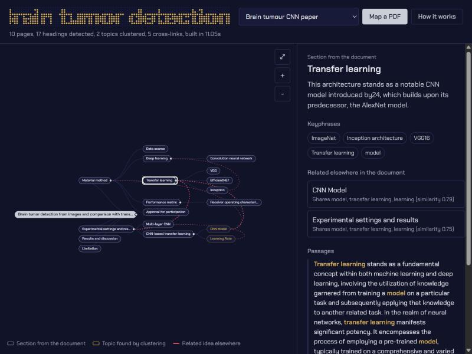

# AutoMap

Turn a PDF into an interactive mind map. Upload a paper and you get its structure as a collapsible tree. Long sections are split into topics, related ideas in different branches are linked, and every node shows the exact passages (with page numbers) it came from.



Most "PDF to mind map" tools paste the text into an LLM and draw whatever comes back. AutoMap builds the map from the document itself:

1. **Layout-aware parsing.** PyMuPDF gives each text block with its font size, weight and position. Running headers and page numbers that repeat in the margins are removed, heading styles are grouped into levels (sizes within 6% count as one level), and front matter before the abstract is skipped. If the PDF's bookmarks actually point at heading text, they win.
2. **The author's structure as the skeleton.** Headings become branches, so the map is organised the way the document is. References and acknowledgements are dropped.
3. **Topics inside long sections.** Passages of about 90 words are embedded with `all-MiniLM-L6-v2` and clustered with agglomerative clustering (cosine, average linkage). The number of topics is chosen by silhouette score. On the few dozen passages a section has, this is steadier than HDBSCAN, which labels most of a small sample as noise.
4. **Labels that come from the text.** Class-based TF-IDF proposes phrases that set a cluster apart from its siblings, and those candidates are re-ranked by embedding similarity to the cluster centroid using maximal marginal relevance (the BERTopic and KeyBERT recipe). Every label is a phrase that appears in the document.
5. **Cross-links.** Nodes in different branches whose content is unusually similar (1.5 standard deviations above the document's mean pairwise similarity) are linked, along with the terms they share.

## Evaluation

There's no gold-standard mind map for an arbitrary PDF, so `automap eval` scores each map against its own source with reference-free metrics, using one shared embedder:

| metric | what it measures |
|---|---|
| coverage | share of passages that some node is about (cosine ≥ 0.35 to what a reader sees at a glance: the label plus two keyword chips, capped at 8 words) |
| grounded | share of labels whose content words all occur in the document (a hallucination proxy) |
| distinct | 1 − mean cosine similarity between sibling labels (less repetition is better) |
| heading recall | share of the parser's detected headings that the map has a matching node for |

Methods compared on the five sample PDFs (a 50-page finance working paper, a Nature *Scientific Reports* article, two course reviews and a one-page poster):

- **automap**: this pipeline.
- **flat**: ablation with headings ignored and clustering only.
- **naive**: the original version of this project (sentences → HDBSCAN, label = first six words of a cluster's first sentence).
- **llm**: one Gemini 3.5 Flash Lite call that returns the whole map from the full text.

| method | nodes | coverage | grounded | distinct | heading recall | words per label |
|---|---|---|---|---|---|---|
| **automap** | 25.0 | **0.98** | **1.00** | 0.74 | **0.84** | 3.3 |
| flat | 5.0 | 0.86 | 1.00 | **0.82** | 0.07 | 1.7 |
| naive | 116.8 | 1.00 | 0.77 | 0.59 | 0.38 | 8.5 |
| llm | 16.6 | 0.74 | 0.80 | 0.76 | 0.42 | 3.2 |

Per-document results are in [`docs/eval.md`](docs/eval.md).

**What this shows.** AutoMap covers the document about as fully as the naive version with a fifth of the nodes and labels less than half as long. It also keeps the author's structure, which neither clustering nor the LLM recovers. The LLM's maps are compact and readable but skip about a quarter of the content, and a fifth of its labels use words the document doesn't contain. The flat ablation has the most distinct labels because it makes only a handful of very broad topics, so the headings are what make the maps detailed.

**Caveats, honestly.** `grounded` is 1.00 for AutoMap by construction, since its labels are extracted. `heading recall` favours AutoMap because it builds on the same parser, so it's reported but not used to rank. Coverage at a fixed threshold saturates for maps with many nodes. Five documents is a small sample, and the LLM outputs are cached locally so the numbers can be reproduced.

## Run it

```bash
python -m venv .venv && source .venv/bin/activate   # Windows: .venv\Scripts\activate
pip install -e ".[dev]"            # add ,llm for the Gemini baseline
uvicorn server:app --reload        # open http://localhost:8000 and click "Map a PDF"
```

From the command line:

```bash
python -m automap build paper.pdf                  # print the outline
python -m automap build paper.pdf -o map.json      # JSON the viewer can open
python -m automap eval samples/*.pdf --llm         # needs GOOGLE_API_KEY in .env (see .env.example)
pytest                                             # 16 tests, offline (uses a TF-IDF embedder)
```

The viewer in `web/` is static. Without the Python server it shows the bundled example maps, so it can be hosted as a static site.

## Layout

```
automap/
  pdf.py        layout-aware parsing: blocks, running-text removal, heading levels, outline
  structure.py  section tree, ~90-word passages, label shortening, boilerplate filter
  embed.py      MiniLM embedder and a TF-IDF + SVD fallback
  topics.py     silhouette-chosen agglomerative clustering, c-TF-IDF + MMR labels
  mindmap.py    puts it together: nodes, summaries, cross-links, JSON
  evaluate.py   metrics and the flat / naive baselines
  llm.py        Gemini baseline (cached)
server.py       FastAPI: POST /api/map, serves web/
web/            D3 viewer
tests/          synthetic-PDF tests for the parser, clustering, labels, API
```

## Limits

Scanned PDFs need OCR first, which isn't built in. Multi-column posters work but are the weakest case, because their reading order is ambiguous. Run-in headings (a bold phrase at the start of a paragraph) are only picked up when the PDF's bookmarks name them.

Example maps: the brain tumour paper is Khaliki & Başarslan, *Scientific Reports* (2024), used under CC BY 4.0.
